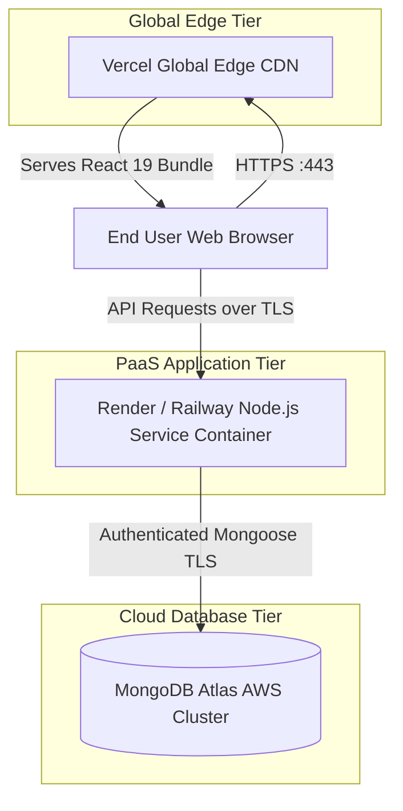

# Business Requirements Document (BRD)
## LeaveFlow — Enterprise Leave Management System

**Document Version:** 1.0.0  
**Status:** Approved & Implemented  
**Author:** Swasthik NJ  
**Organization:** Exeloncircuits Enterprise Systems  
**Date:** October 2026  

---

## 1. Executive Summary & Business Objective

### 1.1 Purpose
The purpose of this Business Requirements Document (BRD) is to define the functional, operational, technical, and deployment specifications for **LeaveFlow**, an enterprise-grade web-based Leave Management System. 

### 1.2 Problem Statement
Legacy leave tracking systems rely on ad-hoc spreadsheets, paper application slips, and unstructured email correspondence. This causes:
- Inaccurate leave balance accounting and lack of audit trails.
- Accidental approval of overlapping leaves resulting in project understaffing.
- Employee confusion regarding remaining annual, sick, or casual leave quotas.
- Delay in administrative reviews and lack of visibility into workforce absence trends.

### 1.3 Solution & Scope
LeaveFlow automates the end-to-end leave lifecycle through an authenticated, role-based platform. Key business capabilities include:
- Employee self-service for leave balance tracking, booking calendar with blocked date detection, and withdrawal.
- Managerial review queue with 1-click approvals, rejections, and audit logging.
- Corporate staff directory synchronized directly with a persistent cloud database.
- Policy administration ensuring compliance with working-day calculations, holidays, and carry-forward limits.
- Complete remote cloud deployment specification with automated CI/CD.

---

## 2. Stakeholders & User Personas

| Persona | Role | Key Responsibilities & Capabilities |
|---|---|---|
| **Employee** | Standard Staff | Applies for time-off, reviews real-time remaining quotas, views corporate policies, tracks application status, and cancels pending leaves. |
| **Manager / Admin** | Approver / HR | Reviews and decides pending leaves (Approve/Reject with comments), onboards staff, activates/deactivates accounts, views analytics and departmental reports. |
| **System Operator / DevOps** | Infrastructure | Manages deployment environments (Vercel, Render, MongoDB Atlas), configures environment variables, monitors system uptime, and handles rollbacks. |

---

## 3. Functional Requirements (FR)

### FR-1: Identity & Access Management
- **FR-1.1**: The system must provide secure user registration and login with bcrypt password hashing (minimum 10 rounds).
- **FR-1.2**: Authentication must issue JSON Web Tokens (JWT) stored in HTTP-only, secure cookies with fallback support for Authorization Bearer tokens.
- **FR-1.3**: Role-Based Access Control (RBAC) must strictly segregate `employee` and `admin` routes and actions.

### FR-2: Leave Entitlements & Balance Management
- **FR-2.1**: Each employee must have designated annual allocations for Paid Annual Leave, Sick Leave, and Casual Leave.
- **FR-2.2**: The system must dynamically calculate and display used days, pending reserved days, and available days.
- **FR-2.3**: Every balance modification must record an immutable audit entry in the `LeaveTransaction` log.

### FR-3: Leave Application & Booking Validation
- **FR-3.1**: The application must automatically calculate net working days between `startDate` and `endDate`, excluding weekends (Saturdays & Sundays) and declared company holidays.
- **FR-3.2**: The interactive calendar must visually disable dates that are already booked (`pending` or `approved`) to prevent duplicate submissions.
- **FR-3.3**: Date selection must visually differentiate statuses using standard color badges (🟡 Amber for Pending, 🟢 Green for Approved).
- **FR-3.4**: All leave types, including Sick Leave, must require administrative approval (`approvalRequired: true`).

### FR-4: Approvals & Rejection Workflow
- **FR-4.1**: Approvers must have access to a centralized queue showing applicant identity, department, date range, working days, and reason.
- **FR-4.2**: 1-Click approval must permanently deduct entitlement from the employee's balance.
- **FR-4.3**: 1-Click rejection must release reserved balances back to the employee's available quota and allow an optional reviewer justification note.

### FR-5: Employee Directory & Administration
- **FR-5.1**: The system must display a real-time list of all employees retrieved directly from the MongoDB Atlas database.
- **FR-5.2**: Administrators must be able to search by name/email, filter by department, onboard new team members, and toggle user status (`active` / `inactive`).

### FR-6: Executive Analytics & Reports
- **FR-6.1**: Real-time KPI summaries must display Total Employees, Currently on Leave, Pending Approvals, and Approved Leaves This Month.
- **FR-6.2**: Departmental absence breakdown and monthly trends must be visualized with interactive charts.

---

## 4. Non-Functional Requirements (NFR)

- **Security**: Strict CORS origin whitelisting, HTTP-only cookie tokens, Helmet HTTP headers defense, and Express rate limiting on sensitive auth endpoints.
- **Performance**: Sub-500ms API response time for all query operations; cached static bundle delivery via global Edge CDN.
- **Scalability**: Decoupled microservices architecture; stateless Node.js API processes capable of horizontal auto-scaling.
- **Availability**: High availability via MongoDB Atlas Multi-AZ replica sets and redundant PaaS runtime instances.
- **Responsiveness**: Fluid layout across mobile screens, tablets, and wide desktop displays.

---

## 5. Deployment Specification

*(Mandatory Section: Explaining hosting destinations, deployment approach, required services, and step-by-step procedures to deploy or update).*

### 5.1 Hosting Infrastructure Overview

The LeaveFlow application is designed and deployed using modern, managed cloud services for optimal reliability, zero-maintenance database operations, and continuous deployment:



| Component | Target Platform | Justification |
|---|---|---|
| **Frontend SPA** | [Vercel](https://vercel.com/) / [Netlify](https://netlify.com/) | Global Edge CDN distribution, instant cache invalidation, automated preview branches, and built-in TLS certificates. |
| **Backend REST API** | [Render](https://render.com/) / [Railway](https://railway.app/) | Managed Node.js containers, automated HTTPS, environment variable protection, health-check monitoring, and continuous Git deployment. |
| **Database** | [MongoDB Atlas](https://www.mongodb.com/cloud/atlas) | Fully managed MongoDB cluster with automated backups, end-to-end encryption at rest and in transit, and replica set redundancy. |

---

### 5.2 Deployment Approach & Strategy

- **Micro-Repository / Decoupled Strategy**: Frontend and backend are maintained in distinct Git repositories (`LeaveManagement_Frontend` and `LeaveManagement_backend`), enabling independent release cycles, zero-downtime rolling updates, and isolated build processes.
- **Continuous Integration & Continuous Deployment (CI/CD)**: Push-to-deploy Git triggers on the `main` branch. Commits trigger automated builds, dependency resolution, asset minification, and atomic live traffic cutover.
- **Environment Isolation**: Separate `.env` configurations for `development` and `production` with distinct database credentials and origin whitelists.

---

### 5.3 Required Cloud Services & Accounts

To deploy LeaveFlow independently, the following cloud accounts and services are required:

1. **MongoDB Atlas Account**:
   - Free or Dedicated Tier M0/M10 Cluster.
   - Database User with `readWriteAnyDatabase` privileges.
   - Network Access IP whitelist entry: `0.0.0.0/0` (allowing serverless/PaaS dynamic IP connections).
2. **PaaS Provider Account (Render or Railway)**:
   - Node.js runtime environment (v18+).
   - Publicly accessible HTTPS domain (e.g., `https://leaveflow-backend-api.onrender.com`).
3. **Static Hosting Account (Vercel or Netlify)**:
   - Vite/React build preset.
   - Publicly accessible HTTPS domain (e.g., `https://leaveflow-frontend.vercel.app`).
4. **GitHub Account**:
   - Repositories:
     - `https://github.com/swasthik-nj/LeaveManagement_backend`
     - `https://github.com/swasthik-nj/LeaveManagement_Frontend`

---

### 5.4 Step-by-Step Backend Deployment (Render)

1. **Log in to Render**: Visit [dashboard.render.com](https://dashboard.render.com/) and authorize via GitHub.
2. **Create New Web Service**:
   - Click **New +** and select **Web Service**.
   - Choose repository: `swasthik-nj/LeaveManagement_backend`.
3. **Configure Service Parameters**:
   - **Name**: `leaveflow-backend-api`
   - **Environment**: `Node`
   - **Branch**: `main`
   - **Build Command**: `npm install`
   - **Start Command**: `npm start`
4. **Input Environment Variables**:
   Add the following secure key-value pairs in the **Environment** tab:
   ```env
   NODE_ENV=production
   PORT=5000
   MONGO_URI=mongodb+srv://<db_user>:<db_pass>@cluster0.b2vfijr.mongodb.net/leaveflow?retryWrites=true&w=majority
   JWT_SECRET=production_super_secret_jwt_key_at_least_32_characters_long
   REFRESH_TOKEN_SECRET=production_super_secret_refresh_jwt_key_at_least_32_characters_long
   CLIENT_URL=https://leaveflow-frontend.vercel.app
   COOKIE_NAME=leaveflow_token
   BUSINESS_TIMEZONE=Asia/Kolkata
   ```
5. **Deploy Service**: Click **Create Web Service**. Wait for the build logs to display `Server running on port 5000` and `Connected to MongoDB Atlas`.
6. **Note Backend URL**: Copy the assigned service URL (e.g., `https://leaveflow-backend-api.onrender.com`).

---

### 5.5 Step-by-Step Frontend Deployment (Vercel)

1. **Log in to Vercel**: Visit [vercel.com](https://vercel.com/) and sign in with GitHub.
2. **Import Git Repository**:
   - Click **Add New...** > **Project**.
   - Select `swasthik-nj/LeaveManagement_Frontend`.
3. **Configure Build Settings**:
   - **Framework Preset**: `Vite`
   - **Build Command**: `npm run build`
   - **Output Directory**: `dist`
   - **Install Command**: `npm install`
4. **Configure Environment Variables**:
   - Under the **Environment Variables** section, add:
     - **Key**: `VITE_API_URL`
     - **Value**: `https://leaveflow-backend-api.onrender.com` *(Backend URL from Section 5.4)*
5. **Deploy**:
   - Click **Deploy**. Vercel will install dependencies, compile the Tailwind CSS styles, build the bundle, and deploy to their edge network.
6. **Link CORS in Backend**:
   - Copy the deployed Vercel domain (e.g., `https://leaveflow-frontend.vercel.app`).
   - If not already set, update the `CLIENT_URL` environment variable on Render with this exact URL to guarantee secure cross-origin cookie sharing.

---

### 5.6 Procedures for Deploying Updates & Maintenance

1. **Local Verification**:
   Before committing, verify all tests and builds succeed locally:
   ```bash
   cd backend && npm test
   cd ../frontend && npm run build
   ```
2. **Pushing Code Updates**:
   Push tested commits directly to GitHub:
   ```bash
   git add .
   git commit -m "feat: release version 1.1 with enhanced leave policies"
   git push origin main
   ```
3. **Automated Rollout**:
   - Render detects changes on `main` and initiates a zero-downtime rolling replacement.
   - Vercel triggers an Edge build and updates production traffic upon build success.
4. **Database Migrations / Seed Updates**:
   - If schema adjustments or new seed policies are required, connect to Render's web shell or run:
     ```bash
     node src/db/seed.js
     ```

---

## 6. Acceptance Criteria

| Criteria ID | Description | Validation Method |
|---|---|---|
| **AC-1** | User can sign in using `njadmin@gmail.com` / `nj@3342` and land on the Administrator dashboard. | UI & Browser Inspection |
| **AC-2** | Applying for leave marks selected dates with color badges and prevents double-booking. | Functional UI Test |
| **AC-3** | Sick leave creates with `pending` status and awaits administrator decision. | API & Database Verification |
| **AC-4** | Rejection restores balance and records reviewer status. | API & Database Verification |
| **AC-5** | Staff directory fetches live employees from MongoDB Atlas. | Network / UI Inspection |
| **AC-6** | Application runs completely independently on remote hosting platform. | Production URL Verification |

---

## 7. Approval & Sign-Off

- **Product Owner**: Swasthik NJ  
- **Lead Architect**: Exeloncircuits Engineering  
- **Release Status**: Ready for Production Deployment  
