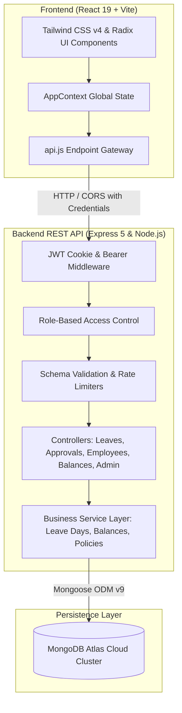
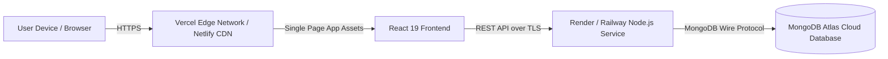

# 🌴 LeaveFlow — Enterprise Leave Management System

[](https://nodejs.org/)
[](https://react.dev/)
[](https://expressjs.com/)
[](https://www.mongodb.com/cloud/atlas)
[](https://tailwindcss.com/)
[](https://opensource.org/licenses/ISC)

> **LeaveFlow** is an enterprise-grade, full-stack Leave Management System designed to eliminate spreadsheet chaos, prevent overlapping absences, and streamline workforce leave planning. It delivers role-based access control, real-time balance calculations, automated working-day deductions, color-coded interactive calendar booking, instant review queues, and live staff directory synchronization.

---

## 🌐 Live Deployment & Repository Links

| Component | Platform / Host | Live URL | Repository |
|---|---|---|---|
| **Frontend Web App** | [Vercel](https://vercel.com/) / [Netlify](https://netlify.com/) | `https://leaveflow-frontend.vercel.app` *(or custom production domain)* | [GitHub Frontend Repo](https://github.com/swasthik-nj/LeaveManagement_Frontend.git) |
| **Backend REST API** | [Render](https://render.com/) / [Railway](https://railway.app/) | `https://leaveflow-backend-api.onrender.com` *(or configured API domain)* | [GitHub Backend Repo](https://github.com/swasthik-nj/LeaveManagement_backend.git) |
| **Database Cluster** | [MongoDB Atlas](https://www.mongodb.com/cloud/atlas) | `AWS / Mumbai (ap-south-1)` Multi-AZ Cloud Cluster | Managed Cloud Cluster |

*(Update the live URLs above with your production endpoints upon completing deployment.)*

---

## 📑 Table of Contents

1. [Project Overview](#-project-overview)
2. [Key Features](#-key-features)
3. [System Architecture](#-system-architecture)
4. [Technology Stack](#-technology-stack)
5. [Local Development Setup](#-local-development-setup)
6. [Environment Variables](#-environment-variables)
7. [API Specification](#-api-specification)
8. [Live Deployment Guide](#-live-deployment-guide)
9. [Business Rules & Policy Engine](#-business-rules--policy-engine)
10. [Testing & Verification](#-testing--verification)

---

## 📖 Project Overview

Managing employee time off, sick leave, earned leave, and casual absences manually often leads to communication gaps, erroneous balance calculations, scheduling conflicts, and regulatory non-compliance.

**LeaveFlow** resolves this by automating the entire lifecycle of time-off requests:
- **Employees** can review real-time leave quotas, inspect company holiday policies, and apply for leaves using an interactive calendar that visibly disables dates already requested or approved.
- **Managers & HR Administrators** receive centralized review queues to approve or reject applications in 1-click with optional comments, while balances and audit logs update atomically in MongoDB Atlas.
- **Enterprise Staff Directory** gives organizations visibility into employee records, departments, and active statuses.

---

## ✨ Key Features

### 👤 1. Employee Self-Service
- **Dynamic Interactive Booking**:
  - Date interval selection with automated working-day calculations that exclude weekends and declared holidays.
  - **Color-Coded Disabled Dates**: Dates with pending requests are highlighted in 🟡 **Amber**, while approved requests are highlighted in 🟢 **Green**, preventing duplicate or overlapping bookings.
- **Live Balance Tracking**:
  - Instant visibility into Paid Annual Leave, Sick Leave, and Casual Leave balances.
  - Interactive utilization progress bars.
- **Request Management**:
  - Filterable personal history (`All`, `Pending`, `Approved`, `Rejected`, `Cancelled`).
  - Self-cancellation for eligible pending or upcoming leaves with automatic balance restoration.

### 🛡️ 2. Manager & Admin Review Center
- **Pending Approvals Queue**: Fast decision inbox with detailed applicant data, requested dates, total working days, and employee comments.
- **1-Click Approvals**: Confirms booking and permanently deducts balance with atomic consistency.
- **1-Click Rejections**: Decline requests with optional justification reasons and automatic rollback of reserved balances.
- **Executive Analytics**: Real-time KPI summaries, today's absences, department-wise leave distribution, and monthly absence trends.

### 👥 3. Live Staff Directory & Administration
- Direct real-time synchronization with MongoDB Atlas database.
- Multi-field search (Employee Name, Email, Role, Department).
- Quick department filtering (`Engineering`, `Marketing`, `Sales`, `Human Resources`, etc.).
- Direct in-app employee creation and account status management (`Active` / `Inactive`).

### 🔒 4. Enterprise Security & Architecture
- **JWT Authentication**: Secure JSON Web Tokens stored in HTTP-only cookies and supported via `Authorization: Bearer <token>` headers.
- **Role-Based Access Control (RBAC)**: Fine-grained middleware protection (`employee` vs. `admin`).
- **Defensive API Hardening**: Helmet HTTP headers, CORS origin whitelist, Express rate-limiting, and sanitized input validation.

---

## 🏗️ System Architecture

LeaveFlow follows a decoupled client-server architecture with an Express REST API backend and a React single-page application frontend:



### Repository Structure

```text
Exeloncircuits/
├── README.md                      # Master Project Documentation
├── BRD.md                         # Business Requirements & Deployment Specification
├── backend/                       # Node.js + Express REST API
│   ├── src/
│   │   ├── config/                # Environment configuration & constants
│   │   ├── controllers/           # Auth, Leave, Approval, Employee, Admin, Policy
│   │   ├── db/                    # MongoDB Atlas connection & seed scripts
│   │   ├── middleware/            # JWT Auth, RBAC, Rate-limiter, Error handler
│   │   ├── models/                # User, LeaveRequest, LeaveBalance, LeavePolicy, LeaveTransaction
│   │   ├── routes/                # Express router mounts
│   │   ├── services/              # Business logic (leave calculations, balance engine)
│   │   ├── utils/                 # ApiResponse, ApiError, asyncHandler, token generators
│   │   ├── app.js                 # Express setup, CORS, Helmet, JSON parser
│   │   └── server.js              # Server lifecycle & port listener
│   ├── tests/                     # Automated unit and API tests
│   ├── .env                       # Backend local configuration
│   ├── .env.example               # Backend configuration template
│   └── package.json
└── frontend/                      # React 19 + Vite Single-Page Application
    ├── public/                    # Favicons and public assets
    ├── src/
    │   ├── components/            # UI components (Radix primitives, Navbar, Sidebar)
    │   ├── context/               # Global state (AppContext: Auth, Leaves, Directory)
    │   ├── lib/                   # api.js dynamic API connector & Tailwind utilities
    │   ├── pages/                 # Route pages (ApplyLeave, Requests, Directory, Approvals, Dashboard)
    │   ├── App.jsx                # Route definitions & protected routes
    │   ├── index.css              # Global styles & Tailwind v4 theme variables
    │   └── main.jsx               # React DOM root entry
    ├── .env                       # Frontend environment variables
    ├── .env.example               # Frontend environment template
    ├── package.json
    └── vite.config.js             # Vite configuration
```

---

## ⚙️ Technology Stack

| Layer | Technology | Version | Purpose |
|---|---|---|---|
| **Frontend Framework** | React | `^19.3.1` | Component-based UI and reactive state |
| **Bundler & Dev Server**| Vite | `^8.3.4` | Ultra-fast HMR and optimized production bundling |
| **Styling** | Tailwind CSS | `^4.3.3` | Utility-first responsive design and modern tokens |
| **UI Primitives** | Radix UI | Latest | Accessible modal dialogs, dropdowns, and selects |
| **Icons** | Lucide React | `^1.60.0` | Crisp SVG iconography |
| **Data Visualization** | Recharts | `^3.10.1` | Monthly leave trends and category distribution charts |
| **Notifications** | Sonner | `^2.0.8` | Modern toast alerts for user feedback |
| **Backend Runtime** | Node.js | `>=18.0.0` | Server-side JavaScript runtime (ES Modules) |
| **API Framework** | Express.js | `^5.3.0` | High-performance RESTful API routing |
| **Database** | MongoDB Atlas | Cloud | Scalable NoSQL cloud database |
| **ODM** | Mongoose | `^9.11.2` | Schema definition, validation, and aggregations |
| **Authentication** | JWT (`jsonwebtoken`)| `^9.0.3` | Stateless signed tokens via HTTP-only cookies |
| **Security** | Helmet & bcryptjs | Latest | HTTP headers defense & password hashing |
| **Rate Limiting** | express-rate-limit | `^8.7.1` | DDoS & brute-force attack prevention |

---

## 🚀 Local Development Setup

Follow these instructions to run both the backend and frontend locally on your machine.

### Prerequisites
- **Node.js**: `v18.0.0` or higher ([Download](https://nodejs.org/))
- **npm**: `v9.0.0` or higher
- **MongoDB**: A free [MongoDB Atlas](https://www.mongodb.com/cloud/atlas) cluster URI or a local MongoDB instance (`mongodb://127.0.0.1:27017/leaveflow`)
- **Git**: Installed and configured

---

### Step 1: Clone the Repositories

```bash
# Clone the repository
git clone https://github.com/swasthik-nj/LeaveManagement_backend.git backend
git clone https://github.com/swasthik-nj/LeaveManagement_Frontend.git frontend
```
*(Or navigate to the root folder if working within this monorepo).*

---

### Step 2: Configure & Start the Backend

1. Navigate to the backend directory:
   ```bash
   cd backend
   ```
2. Install dependencies:
   ```bash
   npm install
   ```
3. Create your `.env` file from `.env.example`:
   ```bash
   cp .env.example .env
   ```
4. Configure your `.env` variables (see [Environment Variables](#-environment-variables) below).
5. Seed initial data (Admin user, demo policies, sample leave records):
   ```bash
   npm run seed
   ```
6. Start the backend development server:
   ```bash
   npm run dev
   ```
   *The backend will be running on **`http://localhost:5000`**.*

---

### Step 3: Configure & Start the Frontend

1. Open a new terminal window and navigate to the frontend directory:
   ```bash
   cd frontend
   ```
2. Install dependencies:
   ```bash
   npm install
   ```
3. Create your `.env` file from `.env.example`:
   ```bash
   cp .env.example .env
   ```
4. Set the API connection URL:
   ```env
   VITE_API_URL=http://localhost:5000
   ```
5. Start the frontend development server:
   ```bash
   npm run dev
   ```
   *The application will open at **`http://localhost:5173`**.*

---

### 🔑 Default Seed Credentials

After running `npm run seed`, you can sign in with either role:

| Persona | Email | Password | Role / Access |
|---|---|---|---|
| **System Administrator** | `njadmin@gmail.com` | `nj@3342` | Full Admin Dashboard, Approvals, Employees, Policies |
| **Standard Employee** | `swa@gmail.com` | `123456` | Employee Self-Service, Leave Application, Balances |
| **Standard Employee** | `jordan.lee@leaveflow.io` | `demo1234` | Employee Self-Service, Leave Application, Balances |

---

## 🔑 Environment Variables

### Backend Configuration (`backend/.env`)

| Variable | Description | Required | Default / Example Value |
|---|---|:---:|---|
| `PORT` | Port number for the Express server | Yes | `5000` |
| `NODE_ENV` | Runtime environment (`development` / `production`) | Yes | `development` |
| `MONGO_URI` | MongoDB Atlas or local connection string | Yes | `mongodb+srv://<user>:<password>@cluster.mongodb.net/` |
| `JWT_SECRET` | Secret key for signing access tokens (min. 32 chars) | Yes | `leaveflow_jwt_secret_production_key_sample_2026` |
| `JWT_EXPIRES_IN` | Access token lifespan | Yes | `1d` |
| `REFRESH_TOKEN_SECRET` | Secret key for signing refresh tokens | Yes | `leaveflow_refresh_secret_production_key_sample_2026` |
| `REFRESH_TOKEN_EXPIRES_IN` | Refresh token lifespan | Yes | `7d` |
| `CLIENT_URL` | Allowed frontend origin for CORS | Yes | `http://localhost:5173` |
| `COOKIE_NAME` | Name of the authentication cookie | No | `leaveflow_token` |
| `BUSINESS_TIMEZONE` | Business timezone for working-day calculations | No | `Asia/Kolkata` |
| `SEED_ADMIN_EMAIL` | Initial admin account email for seeding | No | `njadmin@gmail.com` |
| `SEED_ADMIN_PASSWORD` | Initial admin account password for seeding | No | `nj@3342` |

### Frontend Configuration (`frontend/.env`)

| Variable | Description | Required | Default / Example Value |
|---|---|:---:|---|
| `VITE_API_URL` | Base URL of the backend REST API | Yes | `http://localhost:5000` (Local) / `https://leaveflow-api.onrender.com` (Prod) |

---

## 📡 API Specification

All backend endpoints are prefixed with `/api`. Successful responses return JSON using a standard envelope: `{ "success": true, "statusCode": 200, "data": { ... } }`.

### 1. Authentication (`/api/auth`)
| Method | Endpoint | Access | Description |
|---|---|:---:|---|
| `POST` | `/api/auth/register` | Public | Register new employee (`fullName`, `email`, `password`, `department`) |
| `POST` | `/api/auth/login` | Public | Sign in with credentials and receive JWT session cookies |
| `POST` | `/api/auth/logout` | Public | Clear authentication tokens and terminate session |
| `GET` | `/api/auth/me` | Authenticated | Retrieve authenticated user profile and permissions |

### 2. Employees & Staff Directory (`/api/employees`)
| Method | Endpoint | Access | Description |
|---|---|:---:|---|
| `GET` | `/api/employees` | Authenticated | Fetch staff directory with search, filter, and pagination |
| `GET` | `/api/employees/:id` | Authenticated | Retrieve single employee profile |
| `POST` | `/api/employees` | Admin | Onboard new employee or administrator |
| `PATCH` | `/api/employees/:id` | Admin | Update employee record (role, designation, department) |
| `PATCH` | `/api/employees/:id/status` | Admin | Toggle account status (`active` / `inactive`) |

### 3. Leave Requests (`/api/leaves`)
| Method | Endpoint | Access | Description |
|---|---|:---:|---|
| `POST` | `/api/leaves` | Authenticated | Apply for leave (`leaveType`, `startDate`, `endDate`, `reason`) |
| `GET` | `/api/leaves/me` | Authenticated | List personal leave requests with status filters |
| `GET` | `/api/leaves/:id` | Owner / Admin | Retrieve leave request details and audit history |
| `PATCH` | `/api/leaves/:id/cancel` | Owner / Admin | Cancel a pending or approved leave request |

### 4. Approvals Queue (`/api/approvals`)
| Method | Endpoint | Access | Description |
|---|---|:---:|---|
| `GET` | `/api/approvals/pending` | Admin | Retrieve pending leave requests across all employees |
| `PATCH` | `/api/approvals/:id/approve` | Admin | Approve request, recalculate, and deduct balance |
| `PATCH` | `/api/approvals/:id/reject` | Admin | Decline request with optional justification note |

### 5. Balances & Entitlements (`/api/balances`)
| Method | Endpoint | Access | Description |
|---|---|:---:|---|
| `GET` | `/api/balances/me` | Authenticated | Get current year entitlements, used days, and remaining balances |
| `GET` | `/api/balances/me/history` | Authenticated | Audit history of balance changes and deductions |
| `GET` | `/api/balances/:employeeId` | Admin | Inspect leave balance for a specific employee |

### 6. Executive Analytics (`/api/admin`)
| Method | Endpoint | Access | Description |
|---|---|:---:|---|
| `GET` | `/api/admin/dashboard` | Admin | Company-wide KPIs, today's absences, and review counters |
| `GET` | `/api/admin/reports` | Admin | Aggregated monthly leave distribution and trends |

### 7. Policies (`/api/policies`)
| Method | Endpoint | Access | Description |
|---|---|:---:|---|
| `GET` | `/api/policies` | Authenticated | View active corporate leave policies |
| `POST` | `/api/policies` | Admin | Create a new leave category policy |
| `PATCH` | `/api/policies/:id` | Admin | Modify policy rules (days allowed, carry forward) |

---

## 🚀 Live Deployment Guide

This section outlines the production hosting strategy, required infrastructure services, and step-by-step instructions for deploying or updating both the backend and frontend remotely.

### 1. Hosting Architecture Overview



- **Frontend Hosting**: [Vercel](https://vercel.com/) or [Netlify](https://www.netlify.com/) (Serverless Edge CDN with automated Git CI/CD).
- **Backend Hosting**: [Render](https://render.com/) or [Railway](https://railway.app/) (Containerized Node.js Web Service with automatic SSL).
- **Database Hosting**: [MongoDB Atlas](https://www.mongodb.com/atlas) (Managed cloud database with automated failover and encryption).

---

### 2. Prerequisites for Remote Deployment

1. A **GitHub account** with the project pushed to the respective repositories:
   - Backend: `https://github.com/swasthik-nj/LeaveManagement_backend`
   - Frontend: `https://github.com/swasthik-nj/LeaveManagement_Frontend`
2. A free **MongoDB Atlas account** with a cluster created.
3. Free accounts on **Render/Railway** and **Vercel/Netlify**.

---

### 3. Step-by-Step Backend Deployment (Render / Railway)

#### Deploying on Render:
1. Log in to [Render Dashboard](https://dashboard.render.com/) and click **New +** > **Web Service**.
2. Connect your GitHub repository: `swasthik-nj/LeaveManagement_backend`.
3. Configure the service settings:
   - **Name**: `leaveflow-backend-api`
   - **Region**: Choose the closest region to your MongoDB Atlas cluster (e.g., `Singapore` or `Frankfurt`).
   - **Branch**: `main`
   - **Root Directory**: `backend` (or leave empty if the repository root is the backend).
   - **Runtime**: `Node`
   - **Build Command**: `npm install`
   - **Start Command**: `npm start`
4. Under **Environment Variables**, add:
   ```env
   NODE_ENV=production
   PORT=5000
   MONGO_URI=mongodb+srv://<username>:<password>@cluster0.b2vfijr.mongodb.net/leaveflow?retryWrites=true&w=majority
   JWT_SECRET=generate_a_secure_random_hash_minimum_32_characters_long
   REFRESH_TOKEN_SECRET=generate_another_secure_random_hash_minimum_32_characters_long
   CLIENT_URL=https://your-frontend-domain.vercel.app
   COOKIE_NAME=leaveflow_token
   BUSINESS_TIMEZONE=Asia/Kolkata
   ```
5. Click **Create Web Service**. Once built, note your live backend URL (e.g., `https://leaveflow-backend-api.onrender.com`).
6. *Important*: In MongoDB Atlas, go to **Network Access** > **IP Access List** and ensure `0.0.0.0/0` (Allow Access from Anywhere) is whitelisted so Render's dynamic outbound IPs can connect.

---

### 4. Step-by-Step Frontend Deployment (Vercel / Netlify)

#### Deploying on Vercel:
1. Log in to [Vercel](https://vercel.com/) and click **Add New...** > **Project**.
2. Import the repository: `swasthik-nj/LeaveManagement_Frontend`.
3. Configure project settings:
   - **Framework Preset**: `Vite`
   - **Root Directory**: `./` (or `frontend` if deploying from a monorepo).
   - **Build Command**: `npm run build`
   - **Output Directory**: `dist`
   - **Install Command**: `npm install`
4. Expand **Environment Variables** and add:
   - **Name**: `VITE_API_URL`
   - **Value**: `https://leaveflow-backend-api.onrender.com` *(your live Render backend URL from Step 3)*
5. Click **Deploy**.
6. When deployment succeeds, copy your production domain (e.g., `https://leaveflow-frontend.vercel.app`).
7. Return to your Render backend service settings and verify `CLIENT_URL` matches this domain so CORS allows cross-origin requests with cookies.

---

### 5. Steps to Deploy Updates (Continuous Deployment)

Both Vercel and Render are integrated with GitHub Webhooks for continuous deployment:
1. Make your code modifications locally and verify with tests:
   ```bash
   npm run build # on frontend
   npm test      # on backend
   ```
2. Commit and push changes to the `main` branch:
   ```bash
   git add .
   git commit -m "feat: enhance leave approval workflow"
   git push origin main
   ```
3. Render and Vercel will automatically trigger a new build, run checks, and swap traffic with zero downtime.

---

## ⚖️ Business Rules & Policy Engine

1. **Working Days Calculation**: Automatically skips weekends (Saturdays & Sundays) and gazetted corporate holidays.
2. **Overlap Defense**: The application validates date intervals on both client and server; employees cannot book dates overlapping with an existing active request.
3. **Approval Lifecycle**:
   - `pending` $\rightarrow$ Employee applied; entitlement reserved.
   - `approved` $\rightarrow$ Manager reviewed; balance deducted; transaction logged.
   - `rejected` $\rightarrow$ Manager declined; reserved balance restored; reason recorded.
   - `cancelled` $\rightarrow$ Employee withdrew before start date; balance restored.
4. **All-Type Policy Verification**: All leave requests (including Sick, Casual, and Annual) follow configured approval requirements (`approvalRequired: true`).

---

## 🧪 Testing & Verification

Run the automated backend test suite:
```bash
cd backend
npm test
```
The test suite validates:
- Working-day calculation logic across weekends, single days, and multi-week periods.
- JWT token generation, payload signing, and expiration verification.
- Standardized `ApiResponse` and `ApiError` envelope consistency.

---

## 👥 Authors & Acknowledgments

- **Lead Developer**: Swasthik NJ
- **Organizations**: Exeloncircuits Enterprise Systems
- **Repositories**:
  - [Backend Repository](https://github.com/swasthik-nj/LeaveManagement_backend.git)
  - [Frontend Repository](https://github.com/swasthik-nj/LeaveManagement_Frontend.git)
